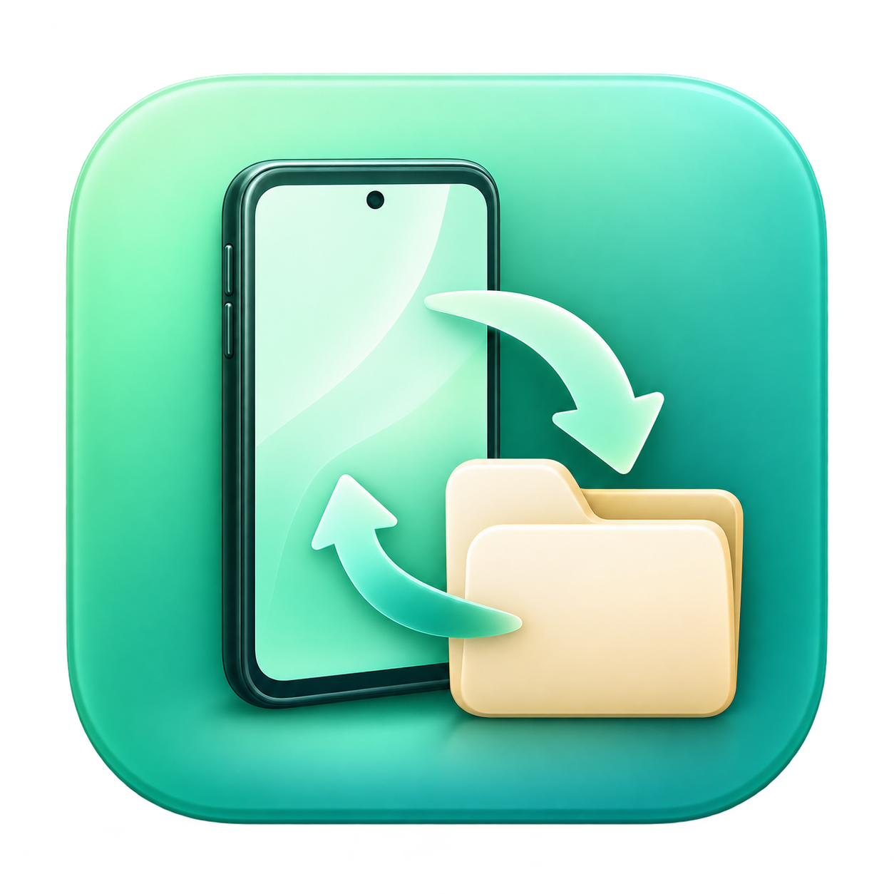

# AndroidMTP

<p align="center"></p>

A native Mac file browser for Android phones. Standard USB **MTP / File transfer** is the default connection; **USB debugging is not required** for normal file access. Version 0.5.0 includes Finder copy/paste transfers, a thumbnail-first photo gallery, and uses the macOS device service so Photos and OneDrive can keep running.

## Features

- Browse the internal storage and SD cards exposed by the phone.
- Upload and download files and folders, create folders, rename items, and delete with confirmation.
- Copy and paste files between Finder and Android, with progress and cancellation.
- Browse photos with small previews, a thumbnail strip, and Open on Mac.
- Use a native sidebar, file list, breadcrumbs, and toolbar inspired by AndroidFileSync.
- Offer extra ADB tools separately, only when the user explicitly chooses them and authorizes their computer on Android.
- Keep transfers local. No account, cloud service, or phone companion app.

## Install on your Mac

### [Download AndroidMTP for Mac](https://github.com/freezingyip/AndroidMTP/releases/download/v0.5.0/AndroidMTP-0.5.0.dmg)

1. Open the downloaded **AndroidMTP-0.5.0.dmg**.
2. Drag **AndroidMTP** onto **Applications**.
3. Open **Applications → AndroidMTP** and connect your phone in USB File transfer mode.

**Apple Silicon Mac · macOS 13 or newer · No Homebrew or Terminal commands.** The app and bundled libraries target macOS 13; the current live verification is on macOS 27. Intel Macs and older macOS installations have not yet been verified.

This preview is not notarized because the project does not yet have a Developer ID certificate. If macOS blocks it and you choose to trust the download, go to **System Settings → Privacy & Security → Open Anyway** for AndroidMTP. See [Apple’s first-open instructions](https://support.apple.com/en-hk/102445). This is a one-time approval for this app.

The ZIP, dependency sources, and checksums under [Releases](https://github.com/freezingyip/AndroidMTP/releases) are optional developer downloads; ordinary installation uses only the DMG above.

## Development

Requirements: macOS 13 or newer, Apple's Command Line Tools with Swift 5.9 or newer, and native Homebrew libraries.

```sh
brew install libmtp pkgconf
./scripts/build.sh
open build/AndroidMTP.app
```

The build script builds the app and copies its MTP libraries into the local app bundle. The source targets macOS 13+, but the packaged app's minimum OS also follows the installed Homebrew libraries. The default development build follows the installed libraries. `scripts/build_portable.sh` builds libusb/libmtp from the verified source archives for macOS 13 and produces `build/portable/AndroidMTP.app`; it needs Python 3.12+, native pkg-config, and the dependency source archives described in `docs/DEPENDENCIES.md`. Set `ANDROIDMTP_PORTABLE_BUILD=1` when running `scripts/package_release.py` to package that build, including the drag-to-Applications DMG. Developer ID signing and notarization remain future work.

Run `./scripts/test.sh` for hardware-free checks of file safety, atomic download completion, cancellation, 64-bit values, PTP codecs, transport routing, recursive chunked transfers, ADB parsing, APK preflight, and gallery decoding, selection, caching, dismissal, and clipboard transfers. Clipboard tests require a local macOS login session with access to the pasteboard service. The optional `./scripts/test.sh --xctest` suite needs an Xcode toolchain with XCTest.

For an optional live-device check, `./scripts/device-check.sh` prepares four harmless local files (including a 5 MB binary and an empty file) and builds the test executable. Run `.build/device-check/roundtrip .build/device-test` with exactly one unlocked phone connected. This explicitly uploads a test folder, renames it, downloads it, checks file hashes, and leaves the test folder on Android. It does not delete or replace existing phone files. It uses the same transport selection as the app.

## Connect a phone

1. Connect an unlocked Android phone with a data-capable USB cable.
2. On the phone, choose **File transfer / Android Auto** (wording varies) and allow file access if prompted.
3. In AndroidMTP, click **Connect Android**, scan, choose the phone, and connect.

The default connection sends normal MTP commands through Apple's ImageCaptureCore service. It cooperates with the photo-import service rather than competing for its exclusive USB interface. A direct libmtp fallback is retained for devices macOS does not discover; that fallback may still require exclusive USB access. Connection errors appear next to the controls. See `docs/STATUS.md` for actual-app and live-device verification.

Standard MTP only exposes the storage Android makes available. Protected app data and restricted Android folders may remain inaccessible. Enabling ADB does not grant root or promise access to private app data.

## Copy and Paste

- **Upload:** copy files or folders in Finder (⌘C), click the file list in the destination Android folder, then paste (⌘V). You can also right-click the file list and choose **Paste to upload**.
- **Download:** select files or folders in AndroidMTP and copy (⌘C). Wait until the status says **Copied… Paste in Finder**, then paste (⌘V) into a Finder folder.

Copy downloads the selection into a temporary local folder before publishing it as normal clipboard files. Finder can paste them after disconnecting the phone or quitting AndroidMTP. Failed/cancelled copies do not publish incomplete results; a newer clipboard is preserved if you copy something else during a transfer. Existing destinations are not replaced during AndroidMTP transfers. Cut/move from Android is not offered. Search and rename text fields keep normal text Copy/Paste behavior.

## Photo gallery

Double-click a photo, select it and press Space, or choose **Photo Gallery** in the toolbar. Browse the current folder's photos with the previous/next buttons, arrow keys, or thumbnail strip. Right-click a photo for **Preview photo gallery** or **Open**; **Open on Mac** uses the Mac's default image app.

The gallery requests small thumbnails directly from the phone and displays previews up to 640 pixels. If the phone has no thumbnail, only originals up to 512 KB are read automatically. For larger photos without a thumbnail, choose **Open on Mac** to download the original explicitly. Phone originals remain unchanged.

Preview reads run one at a time; the first 200 thumbnails are prefetched. The original-file cache targets 512 MB, excluding files retained for a receiving Mac app. Unused temporary files are removed when the gallery closes. Animated images show their first frame.

## App icon

The app uses original mint-and-teal phone/folder artwork. The master is `assets/AndroidMTP-Icon.png`, the packaged macOS icon is `assets/AndroidMTP.icns`, and the generation prompt is saved in `assets/icon-prompt.txt`. After replacing the square master artwork, run `python3 scripts/build_icon.py` on macOS to regenerate all 1×/2× representations, then rebuild the app.

## References

- [OpenMTP](https://github.com/ganeshrvel/openmtp): MTP workflow and compatibility reference. Its current Kalam backend is separate from this implementation.
- [AndroidFileSync](https://github.com/Santosh7017/AndroidFileSync): native macOS UI reference. This project uses original UI code.
- [ImageCaptureCore](https://developer.apple.com/documentation/imagecapturecore): system-managed PTP/MTP connection.
- [libmtp](https://github.com/libmtp/libmtp): direct USB fallback through a small C bridge and protocol layout reference.
- [Android ADB documentation](https://developer.android.com/tools/adb): optional debugging features and computer authorization.

See [the product brief](docs/PRODUCT.md), [development status](docs/STATUS.md), and [third-party notes](THIRD_PARTY_NOTICES.md).

## License

Original AndroidMTP code and artwork are available under the [MIT License](LICENSE). Bundled libmtp and libusb use LGPL-2.1-or-later; see [third-party notices](THIRD_PARTY_NOTICES.md) and [dependency source/rebuild instructions](docs/DEPENDENCIES.md).
